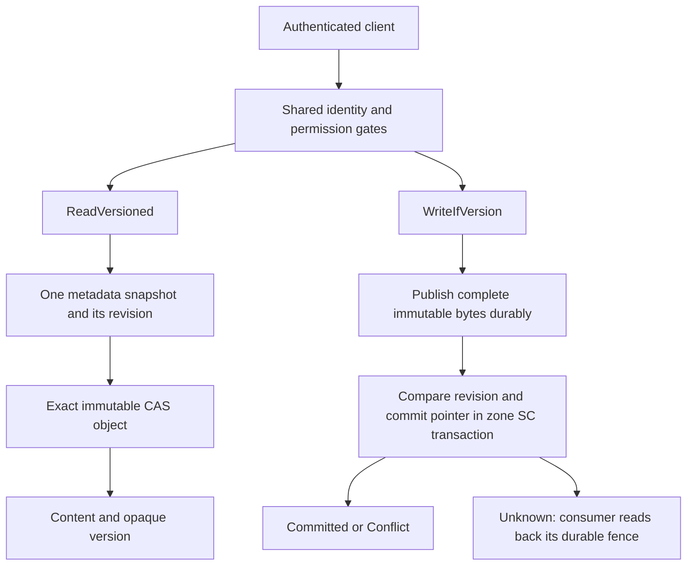

# Conditional file contents

The conditional content pair reads a complete immutable file image with its
committed revision and replaces that image when the revision still matches.
Consumers use the pair for durable records whose updates depend on their
previous contents, including a mailbox reader's committed fence and position.

## Public protocol

[`vfs.proto`](../proto/nexus/grpc/vfs/vfs.proto) owns the wire contract.

| Operation | Input | Successful result |
| --- | --- | --- |
| `ReadVersioned` | Path and existing caller credentials | Snapshot containing bytes and their version, or explicit absence |
| `WriteIfVersion` | Path, complete replacement bytes, credentials and optional expected version | Committed version, or conflict with the current version when present |

An absent expected version requires an absent file. A present token is opaque;
clients preserve its exact bytes. Empty files have a snapshot with empty content
and a nonempty token. The response's selected `oneof` distinguishes an empty file,
absence, conflict and failure.

`Ping.conditional_content_version = 1` advertises support for both RPC messages.
Each resolved path separately qualifies its metadata and object storage. The
operation returns Unsupported when that path lacks the necessary guarantees.
An older service returns gRPC UNIMPLEMENTED for the distinct RPC name. Clients
map that status to Unsupported and preserve the requested precondition.

### Failure outcomes

| Outcome | Meaning | Consumer action |
| --- | --- | --- |
| Unsupported | The path or service lacks the conditional operation | Use a qualified storage path or report the capability requirement |
| Failed | The operation definitely stopped before publishing a new file image | Handle the reported failure |
| Unknown | The replacement may have committed | Read back the consumer's durable fence before deciding what to do next |

Conflicts preserve the visible file image. A write can leave an unreachable
staged immutable object; the existing CAS retention and GC ownership governs it.
Clients send each conditional write once. Connection loss, an incomplete write
response and an unrecognized outcome remain Unknown. Read failures remain
distinct from absence.

The Rust `RpcTransport` and Node `NexusVfsClient` expose the same content/token
and result semantics. Rust's asynchronous calls in
`rpc_transport::conditional_content` accept an existing typed client and request
envelope, preserving its channel, caller credentials, metadata, deadlines and
message limits. `RpcTransport` delegates to those same calls for blocking use.
The Node API represents an absent precondition or file
with `null`; Rust uses `None`. Both clients reject an empty expected token before
dispatch. Both clients preserve a typed Unsupported result from an older server.

## Storage and revision ownership

The [kernel content pair](../rust/kernel/src/kernel/conditional_content.rs)
composes two existing storage capabilities on the resolved mount:

1. `MetaStore::as_conditional_metadata` provides an authoritative snapshot and
   an atomic metadata comparison/replacement.
2. The mounted CAS engine uses a transport constructed with durable immutable
   publication barriers.

`ZoneMetaStore` owns path and subtree translation. Aliases of one backing path
therefore use one metadata image and revision. Directory links re-enter the
target's identity and permission gates. Regular files use this pair; other entry
types and storage without the paired guarantees return Unsupported before
staging objects or changing metadata.

### Metadata admission

The atomic metadata extension belongs to an already bound FixedLocal zone
consensus handle. FixedLocal validates retained membership/history and enforces
its admission policy throughout the runtime's lifetime. Managed membership and
deferred network mounts require their own qualified protocol admission before
exposing this capability.

The managed metadata subtree is `/__managed_content_v1__`, including its
slash-delimited descendants. Its eligibility is a fixed key policy shared by
the EC origin, peer ingress, anti-entropy and state-machine boundaries.
Protected metadata and its allocator enter through SC. An occupied unversioned
image returns Unsupported. Migration conditionally creates a verified image in
the qualified namespace.

The first conditional create commits its explicit metadata image and the
allocator's incarnation together. Reads select an existing database snapshot;
the read path performs no admission or revision allocation. Ordinary SC
Set/CAS/Delete operations update a tracked revision in their existing transaction.
A rejected comparison preserves that revision.

### Token lifetime

The incarnation, allocator and per-path revisions live in the same existing
zone database as file metadata. One zone-wide allocator advances atomically with
the committed image. Deletion retains the allocator, so recreation obtains a
new revision even when its bytes match an earlier file. Aliases share the same
revision, and different files consume distinct allocator values.

Raft snapshots and process recovery preserve the committed incarnation and
allocator. Administrative replacement of a storage lineage requires explicit
incarnation handling before conditional capability admission. Consumers treat
the wire token as opaque rather than deriving it from a content hash, local
clock, PID or the ordinary file generation field.

## Content publication and reads

Read selects metadata once, then obtains the immutable object named by that
snapshot. Missing metadata is absence. Missing, corrupt or incorrectly sized
content is a storage failure. A lagging replica may return an older coherent
image; the subsequent comparison is decided by the authoritative SC transaction.

Replacement stages complete immutable bytes before proposing the pointer and
revision transaction. `LocalCASTransport::new_durable` establishes ancestor and
object-parent barriers, synchronizes candidate bytes, publishes atomically and
synchronizes the containing directory. A deduplication hit verifies and
synchronizes the existing object and directory. The constructor owns platform
qualification; its stronger policy is available on qualified Linux backing.

The CAS transport owns publication, integrity and barrier outcomes, using the
shared `lib::file_durability` facilities. A staging failure occurs before metadata
submission. Once metadata submission is possible, an unsuccessful answer remains
Unknown unless the consensus boundary proves a pre-submit refusal.

CAS file writes preserve manifest-shaped JSON as literal bytes by encoding it
as one raw chunk in the existing canonical manifest format. Reader and writer
share recognition. Raw immutable-object requests return the object addressed by
the requested hash. Partial writes return the computed logical length alongside
their new identifier; ObjectStore uses that result to construct file metadata.
`CASEngine.content_size` measures the physical blob and `get_size` measures the
logical file.

## Authentication, hooks and routing

Both RPCs use the same readiness, authenticated identity and runtime delegation
entry as the other typed VFS operations. `UserRuntimeGateway` forwards both
through the authenticated owner's existing runtime placement. Kernel read
permission/pre-hooks and mutating write hooks remain the operation gates.

Ordinary and conditional writes share metadata construction and successful
commit notifications. A committed replacement emits post-hooks and observers;
conflict and failure return their typed outcome before success notifications.
Content staging runs outside the consensus apply transaction.

## Verification

The [conditional content fixture](../rust/profiles/cluster/tests/conditional_content.rs)
uses the real isolated Raft actor, redb and durable CAS. It covers competing
aliases, unconditional writes, literal JSON, partial writes, corruption,
unsupported storage, directory-link permissions, restart/delete/recreate, native
hooks and coherent concurrent reads. Its RPC cases exercise authenticated wire
requests and disconnect the reply after an actual commit to verify Unknown and
single submission.

The [CI durable runtime job](../.github/workflows/ci.yml) runs the fixture on
Linux and repeats the same compiled binary under the qualified gVisor
ptrace/systrap and directfs/lisafs matrix. The runner derives the expected test
count from that binary. The three-platform CAS job protects publication and
logical-size behavior. Node wire tests protect optional-token presence, typed
outcomes and old-service compatibility.

These checks establish syscall ordering, complete publication and process
recovery against the qualified runtime and backing. Hardware power-loss behavior
depends on the documented OS and storage device guarantees.
