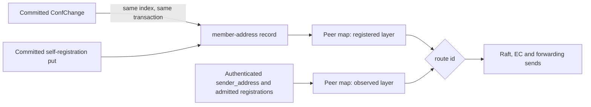

# Member addresses

Every member of a zone's Raft group has one dial address, and the zone's
replicated state machine holds it. A leader, a follower and a learner resolve
a member id to an address from the same applied record, so a restarted node
reaches every member its ConfState names without waiting for that member to
speak first.

## The record

The record lives in the zone's control store under the namespace
`contracts::constants::CONTROL_NS_MEMBER_ADDRESS` (`member-address`), next to
the other control namespaces, and travels in every snapshot with the rest of
`control_state`.

| Part | Content |
|---|---|
| Key | The member's Raft node id in decimal |
| Value | The member's bare advertise authority, `host:port`, canonicalised by the operator-address parser; a wildcard host (`0.0.0.0`, `[::]`) is no dial address and never forms a record |
| Dial endpoint | `http://` or `https://` plus the value, chosen by the reading node's own TLS posture |

`rust/raft/src/raft/member_address.rs` is the only code that builds, decodes
and interprets these records: the put and delete commands, the decoder, the
dial endpoint and the predicate that tells whether an applied batch touched
member addresses. `StateMachine::member_addresses` lists the records a state
machine holds, and answers `None` for a state machine that keeps no control
store and so cannot hold them (the witness).

The namespace is strongly consistent. The state machine's consistency
classifier refuses it on the EC and local write paths, so a record changes only
through a committed Raft entry.

## Write paths

### Membership changes

Applying a committed `ConfChange` or `ConfChangeV2` writes its address effect
into the state machine at the entry's own index, in the same transaction as the
applied-index marker:

| Change | Effect |
|---|---|
| `AddNode`, `AddLearnerNode` with a parsable address in `context` | Put the member's record |
| `AddNode`, `AddLearnerNode` with an empty or unparsable `context` | Nothing |
| `RemoveNode` | Delete the member's record |
| A change raft-rs rejects | Nothing; the entry is still marked applied |

A `ConfChangeV2` carries one shared `context`. It names the address of the
change's single add; a V2 with several adds names none of them. The effect is a
function of the entry bytes alone, so every replica applies the same records.
JoinZone sends the joiner's advertise address as the context, so the leader
holds the joiner's record from the moment the change applies.

### Self-registration

Each resident managed zone keeps its own member's record equal to the local
advertise address, on a data node and on a witness alike:
`transport::start_zone` starts every zone with the same route book, transport
loop and registration task (`rust/raft/src/raft/node/member_registration.rs`).
Each round reads the zone's records:

- from the local state machine;
- for a state machine without records (a witness), from the `GetClusterInfo`
  of its leader, else of its seed addresses, whichever answers first. The
  reported voters and learners carry the answering node's applied records.

A missing or different record is proposed as a member-address put:

1. A node that knows its leader proposes through the normal path (local commit
   on the leader, forwarding on a follower or a witness).
2. When no leader is known or that proposal fails, the node sends a `Propose`
   RPC with `forwarded=false` to every recorded member address and to the
   configured seed addresses (`--peers` / `identity.peers`, a witness's
   `NEXUS_PEERS`), its own address excluded.
3. It repeats with exponential backoff until the records it reads hold its own,
   then stops.

This path registers a founder (its bootstrap entry carries no address), a member
whose address changed, and every member of a zone that predates the record. A
zone with fixed local membership (the isolated local root) has no network
members and does not register; neither does a member without an advertise
address. A zone that is not resident runs no Raft and registers when it next
becomes resident. A witness makes the zones it joins at boot (root and
`NEXUS_FEDERATION_ZONES`) resident when it starts, each on its own, resuming one
it holds on disk from its own storage before re-sending JoinZone; any other zone
becomes resident when a member's message reaches it. A witness never founds a
zone: a replica it opens has no ConfState until its storage or the leader
supplies one.

### RPC admission

The `Propose` handler admits member-address commands as follows:

| Request | Admission |
|---|---|
| Delete | Refused; RemoveNode is the only delete |
| Put, `forwarded=false`, authenticated caller | Key equals the caller's node id, and the caller is a member of the zone |
| Put, `forwarded=true` | A node relaying a request it admitted |

An admitted original put is also the caller's own statement of where it
listens, so the receiving node adds it to its observed routes before
proposing. Members of a zone that all restarted without records reach each
other this way and elect the leader that commits their records.

## Peer map

The transport peer map is a cache derived from the record and from inbound
traffic. It has two layers:

| Layer | Source | Lifetime |
|---|---|---|
| Registered | The state machine's member-address records; empty on a witness | Rebuilt at driver start, after a snapshot install, and after an applied batch that contains a member-address command or a ConfChange |
| Observed | `sender_address` of authenticated inbound Raft messages, and the address of an admitted original registration | Memory only; an entry for an id is cleared when that id's registered record changes |

`route(id)` returns the observed address, else the registered address. The
local node is never a peer. Ordinary applied batches do not touch the map, and
the send path reads it under one shared lock per batch of outgoing messages.

## Raft contract

- Records change only through committed entries, applied in log order on every
  replica. Each change commits atomically with the applied-index marker, so a
  replayed entry at or below the marker writes nothing twice.
- `RawNode::apply_conf_change` remains the only membership authority; the record
  is the address effect of the same entry, never a second membership list.
- The snapshot holds the records and the ConfState of one applied index, and a
  snapshot install replaces both together. A restarted node rebuilds its routes
  from the restored state.
- Routing reads applied state plus transport observations. Nothing outside apply
  writes the state machine.
- Registration only proposes. A witness reads another member's applied records
  and changes nothing locally; a stale read costs at most a repeated put of the
  same value, which applies idempotently.
- The founder's bootstrap entry is pre-applied and carries no context; the
  founder's first self-registration commits its record like any other put.

## Migration

A zone created before the record exists has members in its ConfState without
records. Each member, a witness included, registers itself the next time the
zone becomes resident on it, using the recorded addresses it reads and its seed
addresses. A learner that its leader can no longer reach therefore restores the
leader's route by sending its own registration to a seed address, and
replication resumes once that put commits on the leader. A witness and a leader
that restart together without the witness's record meet the same way: the
witness resumes the zone at boot and sends its registration to a seed, the seed
routes to it, and the witness's vote counts in electing the leader that commits
the record.

`identity.json` keeps the operator's seed addresses (`peers`) and the node's
per-zone role intent (`zones[].zone_id`, `zones[].as_role`). Fields that older
versions wrote under `zones[]` load and are ignored. A node whose data
directory was wiped rejoins its remembered zones through a seed; with zones
remembered and no seed known, boot refuses rather than founding those zones
again.

## Visibility

- `GetClusterInfo` lists voters and learners, and the leader address, with the
  addresses the local state machine records for them, including the local
  node. A member without a record appears with an empty address. JoinZone's
  returned configuration uses the same records.
- The transport warns once when a member has no registered or observed route,
  and again only after its route has existed and gone.
- `ZoneStatus` cluster facts carry `leader_contact_age_ms`: the time since this
  node last received a message from its current leader, measured in memory. It
  is zero on the leader and absent before the first contact.
