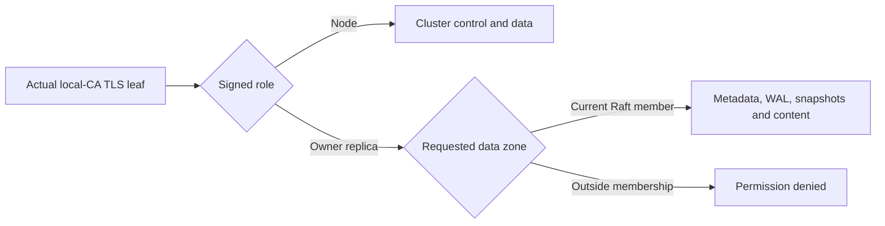

# Node control authorization

The cluster listener authenticates the actual TLS client leaf against the
local cluster CA and current certificate validity. `RaftGrpcServer` applies
the resulting identity to both `ZoneTransportService` and `ZoneApiService`.
Domestic and registered foreign Agent certificates use the cohosted VFS
authorization policy. Replication and control use the roles below.

| Identity | Authority |
|---|---|
| Canonical local Node URI | Cluster control and data operations |
| Owner runtime leaf with one canonical `nexus://replica/{id}` URI | Data operations in its current Raft membership |
| Ordinary Agent or foreign Node | Its existing VFS and delegated issuer permissions |

The owner replica leaf retains the signed Agent subject, owner and owner
server name. The issuer assigns the nonzero replica ID. Zone membership
determines its replication visibility. The shared certificate parser verifies
the exact identity shape, including duplicate URI rejection. Proof-bound
renewal preserves that identity while rotating the leaf key and serial.

## Zone data boundary

The shared data-zone authorizer checks tenant zone naming, local residency and
the live Raft membership before parsing payloads, learning routes or reading
data. Its paths are `StepMessage` (including Raft snapshots),
`ReplicateEntries` (EC WAL), `SnapshotEcState`, `Propose`, `Query`,
`GetClusterInfo`, `GetSearchCapabilities` and `ReadZoneBlob`.

One ephemeral membership snapshot comes from the driver's Raft
`ProgressTracker`, covering incoming/outgoing voters and learners. Completion
of a membership change publishes that view before acknowledging the change.
The network address book supplies routing. EC replication recipients use the
same live membership source. Raft members retain the standard trusted-member
model; this boundary is not a Byzantine consensus protocol.

`ReadZoneBlob` uses the admitted zone's authoritative metadata and physical
content namespace. Logical file paths resolve within that metadata; raw CAS
hashes resolve within that physical namespace. Links and mount aliases retain
their existing VFS semantics at the VFS boundary. Scoped peer clients use the
same explicit RPC across versions and preserve an unsupported-method error.
See [profile storage composition](../rust/profiles/README.md).

## Outgoing replication identity

The Raft peer pool connects to the Node ID selected by the transport's route.
TLS verifies that exact signed Node or owner-replica ID, alongside the trusted
CA chain, certificate lifetime, server key usage and handshake signature.
Node certificates use the cluster service name; owner replicas use the service
name derived from their signed owner. Credential issuance and both directions
of TLS admission share the same identity parsers.

Cached connections retain their route and TLS configuration. A route or
credential change requires a fresh connection. A dial whose TLS configuration
changed while it was connecting returns an error before publishing its channel.

## Control and local root

Membership administration, global topology, unscoped `ReadBlob`, key
management and trust administration require the Node role. New control RPCs
default to Node-only, and `RaftWitnessServer` keeps that policy for every data
and control RPC. Owner replica `MsgPropose` requests also reject membership
change entries. Raft request relaying follows raft-rs's existing contract.

The local root uses fixed local membership. Its shared EC ingress enforces
the same fixed-membership boundary for incremental WAL and state snapshots.
Explicit zone admission governs a local-root runtime's data zones.

The four delegated credential methods (`MintSessionAgent`, `MintUserRuntime`,
`RenewSessionAgent`, `RevokeAgentCert`) retain their native issuer allow-list
and ownership checks. Excluding these routes from the Node wrapper does not
authorize issuance. The local issuer/admin implementations independently use
the same local-CA/Node verifier, including the Node branch of revocation.
The separate token-gated enrollment listener and cohosted VFS routes keep
their existing authorization boundaries.

An explicitly plaintext development listener retains its development
contract. Issuer and revocation policy remain owned by their existing
credential services; certificate-role parsing identifies the peer.

## Regression coverage

`raft/tests/node_rpc_boundaries.rs` uses real mTLS and native Raft stores to
check Node control, replica membership, removal on an existing connection,
metadata/WAL/snapshot refusal, fixed-local EC refusal and witness isolation.
It also exercises exact outgoing peer identity, owner-replica server names,
foreign-issuer refusal, route changes and credential rotation during a dial.
`profiles/cluster/tests/zone_content_blob.rs` checks real mTLS and durable
Linux CAS namespaces, including known hashes and forged cross-zone pointers.
`transport/src/peer_blob/tls_tests.rs` checks production client transport,
credential rotation and unsupported scoped reads against real gRPC endpoints.
The Node-control CI matrix runs on Linux, Windows and macOS; the durable
content CI job exercises Linux's durable CAS implementation.
