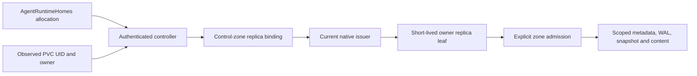

# Replica issuer and durable allocation binding

The native control plane binds an owner allocation to its observed durable
storage incarnation and a replica ID. `AgentRuntimeHomes` supplies the
canonical allocation. `UserPodService` verifies the current resource owner,
UID and resource version before requesting issuance. The stored identity uses
the storage authority and PVC UID; a replacement Pod using that PVC retains
the allocation binding.

## Binding authority

`contracts::replica_binding` owns the native types.
`RaftReplicaBindingStore` exposes four operations:

| Operation | Result |
|---|---|
| `apply(request)` | The original operation's committed outcome |
| `current(allocation)` | The current binding at one control-zone ReadIndex |
| `current_for_replica(id)` | The current binding reached by its retained replica reservation |
| `reconcile(request)` | The matching original receipt, a payload mismatch, or an unresolved observation |

Each request carries an operation ID and a canonical owner/allocation pair.
The native allocator chooses the replica ID. Its reservations cover enrolled
Node identities and replica identities in the same issuer authority. The
binding store retains replica reservations across retirement and replacement.

`reserve_node(request)` records an enrolled Node ID and the SHA-256 of its
verified public key. `node_identity(id)` and `reconcile_node(request)` read
the retained identity and original operation receipt through the same authority.
Node enrollment and replica allocation contend on the same `node:<id>` index.
Each reservation retains its original holder across retries and cold restart.
The controller records the original operation and verified key before submitting
it. Enrollment retries recover that exact operation; an existing identity's key
rotation requires a separate authenticated transition. Founder enrollment uses
the existing native Node ID and public key at this boundary.

The control-zone state machine applies each transition, replica reservation
and operation receipt in the same transaction as its Raft last-applied marker
and minimum storage-reader format. The format requirement increases monotonically
at the existing storage-admission key and survives compaction and snapshots.
Boot and snapshot admission check that the reader supports the retained format
and that its membership policy qualifies the stored records.
Generic control writes are refused for this owned namespace. EC admission
requires these mutations to use the consensus path.

Node reservation uses the `node-identity-v1` reader floor at that same admission
key. Its ID record, public-key binding, original receipt and last-applied marker
commit in one transaction. Existing allocation references retain their format.

| Transition | Required current state | Result |
|---|---|---|
| Register | Allocation absent; replica ID available | Active generation 1, revision 1 |
| Retire | Active binding at the expected revision | Retired binding, revision advanced |
| Replace | Retired binding at the expected revision; fresh replica ID | Active next generation, revision advanced |

A PVC with a reused name and a different UID requires explicit replacement.
The request carries the observed revision, and the state machine checks it at
apply. An existing operation ID returns its original result for the same
payload. A changed payload is rejected. Historical receipts preserve their
original result after a later retirement; `current` supplies present authority.

The controller retains the exact request before submission. A lost proposal or
read-barrier response produces `Unknown`. Reconciliation preserves that
operation and replica identity. An absent receipt at one read point remains
unresolved while the original proposal can still commit.

## Credential publication and renewal

The native issuer verifies the authenticated controller, current issuer,
observed allocation/storage ownership and active binding generation. A renewal
also proves possession of the existing leaf key and preserves its owner,
allocation and replica identity. The issuance intent binds the operation ID,
CSR/public key, expected binding revision and current issuer identity.

The public certificate receipt and issuance lineage are durable facts. The
private key stays with its credential holder. Publication checks the binding
revision and current issuer in its committing authority; retries reconcile the
original intent and certificate. A historical binding receipt alone does not
authorize signing or credential publication.

Retirement immediately prevents new publication against that binding.
Revocation completion additionally requires current issuer/serial evidence and
the affected data-zone admission changes. Each zone applies its membership
change before acknowledging its own removal. Readiness and revocation receipts
identify the actual completed boundaries; a control-zone observation alone
does not fence a later write in another zone.

## Composition and readiness

The controller provides a verified binding to the existing owner-runtime
credential publication and reload path. Root/W7's managed Agent instance,
durable SID and child bootstrap remain separate identities. The local root
retains its persistent local Node ID and storage.

A federated runtime becomes ready after current issuer/credential validation,
explicit zone admission, expected remote peer verification and the required
durable content checks. Runtime addresses, PIDs and Pod readiness are observed
at their runtime authorities. Source-offline recovery requires complete durable
content publication, including referenced attachments and cold stream content.

Control-zone members and snapshot recipients qualify the appended command
format before the issuer exposes these mutations. The enforced-local storage
door supplies the single-binary transaction boundary; managed membership
requires its protocol activation before proposal or forwarding. The consumer preserves
unsupported-version, authentication, revocation, transport and storage errors.
Its readiness result is derived from those authorities.

The [Node control contract](node-control-authorization.md) defines the transport
and zone boundary. Issuer allocation binding and zone membership each supply
their own authority; the business adapter consumes the resulting trusted host
context through the application backend.

## Regression coverage

`raft/tests/replica_binding_authority.rs` exercises competing claims, original
operation reconciliation across cold restarts, explicit retirement and replacement
through the actual enforced-local Raft driver, and verifies managed-control refusal before
an unactivated command enters the log. State-machine tests cover snapshot restore,
identity reservation retention, stale revisions, payload mismatch and refusal
of generic/EC writes. The Node-control CI matrix runs these on Linux, Windows
and macOS.

The same real-Raft suite races Node enrollment against replica allocation and
recovers the original public-key binding after restart. Durable-admission tests
cover Node-only applied, compacted and snapshot images; the previous-reader
fixture opens those images as well as replica images before any restore.

`test_durable_storage_admission.rs` covers applied and compacted restart,
snapshot-only recovery, incoming snapshot refusal and successful fixed-local
recovery. The Linux Node-control job also builds the pinned previous reader
and opens current native fixtures, verifying format refusal before restore
for both managed and fixed-local membership.
